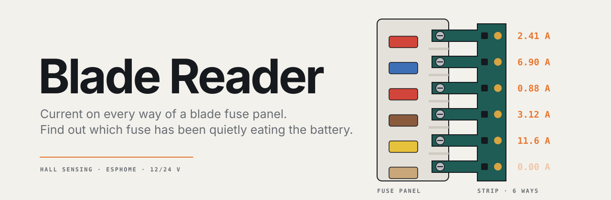

  

  
  
  
  

---

**Blade Reader** measures the current on every way of a blade fuse panel and sends it to Home
Assistant. A battery monitor tells you how much power is leaving the battery. Blade Reader tells
you where it is going.

> It reads blade fuses. Any resemblance to a 1982 film is the fault of whoever named it.

> [!NOTE]
> Blade Reader is being designed. No board has been ordered yet, so everything below describes
> the intended design, not a tested one.

## How it works

Each board is a 6-way **strip** that sits along one long side of the fuse panel. It is shaped
like a comb: one finger slides sideways into each way's pocket and is clamped under the panel's
own output screw. Current runs from the panel, along the finger, through a hall-effect sensor,
and out to an M4 stud on the strip, where the circuit's existing ring terminal lands. No
re-crimping, and the panel's cover still goes back on.

- **Sensing:** one hall-effect sensor per way, with its own 0.6 mΩ current path. It is rated to
  30 A per way, and none of the panel's bus current crosses the strip.
- **Brains:** an ESP32-C3 on every strip, running ESPHome, reporting over Wi-Fi. Each strip is a
  self-contained device; there are no cables between strips.
- **Power:** taken from whichever of the strip's own ways are live, through a diode on each,
  with a fuse on the board and one ground wire to the negative bus. It accepts 12 V and 24 V
  systems.
- **Accuracy:** aiming for about ±0.3 A, after zeroing each way in firmware and correcting for
  board temperature. That is enough to find the heater, fridge or inverter responsible for the
  missing amp-hours. It is not a laboratory instrument. A way drawing a few milliamps will read
  as zero.

A 12-way panel takes two strips, one per side.

## Compatibility

| Fuse panel | Status |
|---|---|
| Blue Sea Systems ST Blade, 12 circuit (5026) | Target. Way pitch 13.36 mm, #8 output screws |
| Blue Sea Systems ST Blade, 6 circuit | Expected to fit the same strip; not yet checked |
| Generic blade fuse boxes | Wanted. Pitches and terminals vary, so this may need strip variants |

## Repository

| Path | What |
|---|---|
| [`docs/design.md`](docs/design.md) | The design as decided so far, with the reasoning and the numbers |
| [`docs/research/`](docs/research/) | The research behind each decision: sensors, ADC, terminals and copper, power, JLC assembly, panel dimensions |
| `docs/assets/` | The banner, and later renders of the board |

The board itself will be designed in [tscircuit](https://tscircuit.com) and ordered assembled
from JLCPCB. The source, the fab files and an ESPHome configuration will land here as they are
made.

## Licence

The hardware design is licensed under the [CERN Open Hardware Licence v2, Strongly
Reciprocal](LICENSE). You may build, modify and sell boards made from it. If you distribute a
modified design, you must publish its source under the same licence.
